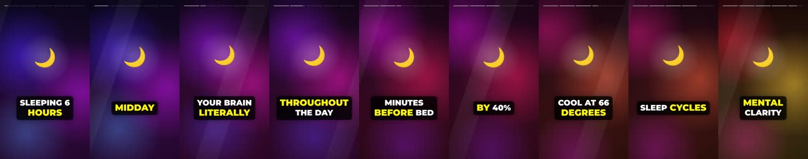
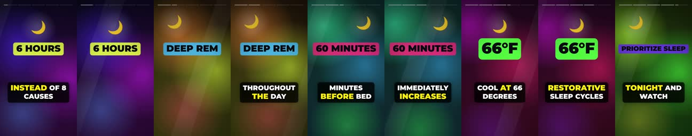

# Forge Reel Quality: audit of `forge_short_1080p_1795100225422.mp4`, root-cause fixes, and the evaluation engine

Status markers: **VERIFIED** = reproduced on the actual file or by executing the code; **CODE** = proven by reading
the code path; **LIMITATION** = known gap, stated plainly.

## 1. Architecture map (one reel, user input → MP4)

```
User input
 ├─ Idea      → POST /api/generate-script (server.ts, Gemini or labelled template) → beats
 ├─ YouTube   → POST /api/youtube/generate-clips (+ pasted transcript) → clip beats (speaker's words, transcript times)
 └─ Own video → POST /api/clips/from-transcript → clip beats + the user's file (never uploaded)
        │
 Scene media   App.withSceneMedia: per-scene POST /api/stock-footage → pickDistinctAssets (no repeats)
 Voice         audio.ts prefetchLines → POST /api/tts → neural (Gemini) | offline (ffmpeg flite)  [server/lib/offlineTts.ts]
 Word timing   alignment.ts alignWordsToAudio(real narration PCM)  |  transcript times  |  estimate (labelled)
 Captions      pipeline.chunkCaptionPhrases (renderer-measured, ≤2 lines) → exportCanvas.drawCaptionChunk
        │
 Pre-render    POST /api/quality/precheck (plan only, no ffmpeg) → blocks unrecordable voice, missing scenes, broken captions
        │
 Render        ShortsPlayer.recordOnce: canvas 1080×1920, real time, 30 fps
               narration scheduled on the AudioContext clock (scheduleNarration), source/music routed to the export
               stream, live meter on what the recorder receives, captions moved off detected faces (sampleSubject)
               MediaRecorder (H.264 first, other encoder on re-record)
        │
 Evaluate      POST /api/quality/uploads → POST /api/quality/evaluate {async:true} → GET /api/quality/jobs/:id
               probe (ffprobe + ffmpeg filters + PCM/frames analysed in Node) → evaluate raw → conform (repair) →
               probe again → AI story review (optional) → evaluate → classify → recommendations
        │
 Deliver       GET /api/quality/download/:id — named by MEASURED size; Poor reels need "Download anyway"
```

| Stage | Component |
|---|---|
| Script | `server.ts` `/api/generate-script`, `server/lib/llm.ts` |
| Clip selection | `server/lib/youtube.ts`, `/api/youtube/generate-clips`, `/api/clips/from-transcript` |
| Voice / TTS | `src/utils/audio.ts` (`prefetchLine(s)`, `scheduleNarration`), `/api/tts`, `server/lib/offlineTts.ts` |
| Audio mixing | Web Audio graph in `audio.ts` → `MediaStreamAudioDestinationNode` → MediaRecorder |
| Subtitles | `src/utils/pipeline.ts`, `src/utils/alignment.ts`, `src/utils/exportCanvas.ts` |
| Composition | `src/components/ShortsPlayer.tsx` `recordOnce` |
| Asset selection | `src/App.tsx` `withSceneMedia`, `pickDistinctAssets`, `/api/stock-footage` |
| FFmpeg | `server/lib/videoQuality/probe.ts` (measure), `server/routes/quality.ts` `conformArgs` (repair) |
| Evaluation | `server/lib/videoQuality/*` |
| UI | `src/components/QualityReportCard.tsx` |

## 2. The failed reel, measured (VERIFIED on the file from Drive)

| Property | Measured | Notes |
|---|---|---|
| Container | 1080×1920, H.264 Constrained Baseline, yuv420p, fragmented MP4 (iso5), VFR (declared 600 fps, 30.07 avg) | |
| Audio stream | AAC LC 48 kHz stereo, **2.25 kbit/s** | |
| Decoded audio | **peak −∞ dB, RMS −∞, 0 zero crossings** — every sample is zero | *The stream exists; the signal does not.* |
| Picture | **1 visual state for 27.5 s** (a single still with a slow zoom) | 23 of 27 per-second hashes looked "distinct" because of the zoom |
| Real detail | **≈270×480** (downscale/upscale round trip loses nothing even at 4×: 47 dB) | a ≤480×360 YouTube thumbnail stretched to 1080×1920 |
| Distinct frames | 5.2 / s | still image |
| Captions | 2-word chunks crossing sentence ends ("YET KEEP", "LOOKING DON'T", "SETTLE AS") | 89% fragments |

**Issue #1 (512×910) does not reproduce on this file**: it is 1080×1920. What *does* hold is that only ≈270×480 of
real detail exists, which a dimension check cannot see. The earlier reel (`…94386694.mp4`) is also 1080×1920 with the
same digital-zero audio.

**Provenance (VERIFIED):** the file name `forge_short_1080p_…` is produced only by code *before* commit 7a58f79
(current code names files by measured size); its timestamp (14:57:05 UTC) is after the commit (14:42) but the
deployment evidently still ran the older build.

## 3. Root causes

| # | Symptom | Root cause | Status |
|---|---|---|---|
| R1 | Audio stream present but silent | YouTube-link-only clip: the speaker's voice plays from the **embedded YouTube player, which a canvas recorder cannot capture**; music was off. `getExportAudioStream()` attaches a zero-offset `ConstantSource` keep-alive, so the MP4 *always* gets an audio stream — of zeros. | CODE + VERIFIED |
| R2 | Same silence for scripted reels with "AI voice" | When neural TTS is unavailable the client fell back to `speechSynthesis`, which plays through speakers but is **never routed into the export graph**. | CODE |
| R3 | Narration cut off / late | TTS was fetched when each beat started (network round trip mid-recording) and stopped by the next beat. | CODE |
| R4 | Gate let the silent reel through | Client sent `audio.required = musicEnabled` (false) → the old engine scored the silent speech clip **80.3 / NEEDS_IMPROVEMENT**; story 15/15 for one still; visual 18/20 for a 4× upscale. | VERIFIED (old engine on the file) |
| R5 | Static visuals | Link-only clip beats get `video_url: ''` and the same `hqdefault.jpg`; the export showed it for the whole reel (old code). | CODE + VERIFIED |
| R6 | "512×910" / soft picture | Upscaled 480×360 thumbnail; metadata says 1080×1920. | VERIFIED |
| R7 | Caption fragments / sync | Old default 2-word chunks; word times estimated from text length. | VERIFIED + CODE |

## 4. Fixes

**Audio**
- `speechPlan()` (ShortsPlayer) states who speaks and whether it is recordable (`neural-tts | offline-tts | source-file`
  vs `youtube-embed | browser-tts | none`); sent in the timeline.
- **Pre-render check** (`/api/quality/precheck`): an unrecordable voice is a *critical* defect, so the reel is blocked
  **before** a 30-s recording, with the fix offered ("Add video file" / "Use AI voice").
- **Offline voice** (`server/lib/offlineTts.ts`): when Gemini TTS is unavailable `/api/tts` now returns real PCM from
  ffmpeg's flite (bounded: 2 processes, 24 waiting, 20 s kill, 1000 chars), labelled `engine: 'offline'`.
- Narration **scheduled on the AudioContext clock** before recording starts; recorder starts at `t0`.
- Live **meter on the export stream** (what the recorder actually receives).
- Engine: silence is critical unless the creator explicitly set `silentIntended`.

**Video/export**: unchanged conform (H.264 High, yuv420p, CFR 30, AAC 48 kHz, −14 LUFS, faststart, never upscales);
new checks: effective detail, decodable-frame integrity, timestamps, A/V offsets.

**Visuals**: link-only clips get per-scene footage (distinct, keyword-matched); "Find new footage" re-picks excluding
shown media; captions are moved to the height that covers the least detected skin per scene.

**Captions**: word timings aligned to the real narration PCM (`alignWordsToAudio`: pause detection → DP grouping at
punctuation → dip snapping). Measured on synthesized speech with exact ground truth: **mean word-start error 65 ms vs
207 ms** for the previous estimate. Caption box geometry and subject overlap are reported to the engine.

## 5. Evaluation engine (`server/lib/videoQuality/`)

| Dimension | Weight | Measured from |
|---|---|---|
| Audio | 15 | decoded PCM: peak/RMS/digital silence, voice-band activity, 2–8 Hz syllabic modulation (speech vs tone/music/noise), voiceover coverage of caption spans, EBU R128 loudness, clipping |
| Video & export | 15 | ffprobe: size, 9:16, codec, pixel format, fps, audio codec, faststart, duration, decodable frames |
| Visual | 20 | effective detail (tile-median round-trip PSNR), blur, black, freeze, visual states (cut/drift on 2 fps thumbnails), scene diversity, repeats, exposure/contrast, scenes rendered, subject under captions |
| Captions | 15 | coverage (LCS), overlaps, range, fragments, orphans, overflow, safe area, word-timing provenance, highlight sync, sync to measured speech |
| Story | 15 | hook in first 3 s (measured speech onset), structure, information progression, visual progression, ending, CTA, keyword relevance; optional AI review |
| Pacing | 10 | measured cut cadence, planned scene length, speech rate, dead air, black gaps |
| Technical | 10 | A/V duration and start offsets, speech-vs-caption global offset (overlap maximisation), DTS order, frame gaps, CFR jitter, sample rate |

**Classification**: ≥90 Excellent (ready to publish), ≥80 Good (minor warnings), ≥70 Needs improvement (revision
recommended), else Poor (regeneration required). Any critical → Poor; any major → at best Needs improvement.
Unmeasurable checks are reported and excluded, never guessed.

**AI review** (`aiReview.ts`): Gemini through the server's `llmJson`; receives the scene plan and measured facts only;
every criterion must quote the script — quotes not found verbatim are ignored for scoring; AI checks can never be
critical. Without a key the report says storytelling used proxies only.

**Repairs** (`repairs.ts`): every failed check maps to an action. Automatic and deterministic only: `remux_conform`
(server) and `rerecord` (client, max 1, never for content problems such as an unrecordable voice). Creative actions are
recommendations with one-click editor actions where safe. Evaluations per upload are capped at 3.

**Async**: `evaluate {async:true}` returns a job id; ffmpeg work runs in child processes behind a FIFO (max
`QUALITY_MAX_CONCURRENT`); structured JSON logs (`scope: quality`).

## 6. Calibration (real signals)

| Signal | Speech ratio | Modulation |
|---|---|---|
| flite speech (2 voices) | 0.87–0.88 | 0.56–0.62 |
| speech + music | 0.69 | 0.54 |
| synth chords / 440 Hz tone / white noise | 0.00 | 0.32 / 0.00 / 0.35 |
| failed reel | 0.00 (digital zero) | — |

| Picture | k=2 / 3 / 4 PSNR (dB) | effective width |
|---|---|---|
| failed reel | 53.2 / 50.1 / 47.1 | 270 |
| 203-px source stretched | 51.1 / 45.8 / 41.7 | 360 |
| sharp 1080 test pattern | 38.7 / 35.5 / 34.2 | 1080 |
| Mandelbrot (smooth regions) | 27.3 / 26.3 / 25.6 | 1080 |
| flat colour | — | "too smooth to judge" |

Visual states (32×56 MAD): cuts jump 40–75; slow zoom drifts ≤2 per sample; the failed reel's per-scene zoom reset
jumps 12.6 → cut threshold 15, drift 30, cluster 25.

## 7. Before / after (same inputs, real UI in Chromium, previous commit vs this change)

Two scenarios, driven by the same script against both builds (no Gemini key, no stock-footage network — the
conditions that produced the reference reel):
**A** = the reference reel's situation: YouTube link + pasted transcript, no video file, music off.
**B** = idea → Short ("5 science-backed habits to fall asleep faster"), AI voice on, music off.

| Measured on the file | Reference reel | A before | A after | B before | B after |
|---|---|---|---|---|---|
| Size | 1080×1920 | 1080×1920 | 1080×1920 | 1080×1920 | 1080×1920 |
| Audio peak / RMS (dBFS) | −∞ / −∞ | −∞ / −∞ | **−3.5 / −19.8** | −∞ / −∞ | **−4.8 / −19.9** |
| Loudness (LUFS) | −70 | −70 | **−14.1** | −70 | **−14.2** |
| Speech-like audio | 0% | 0% | **86%** | 0% | **88%** |
| Visual states / distinct pictures | 1 / 1 | 5 / 2 | **6 / 3** | 2 / 1 | **5 / 2** |
| Real detail (effective width) | 270 | 540 | **1080** | 540 | **1080** |
| Caption word timing | estimated | estimated | **aligned to voice** | estimated | **aligned to voice** |
| Gate shown to the user | — | old: "Needs improvement 92" and **auto-downloaded silent** | **blocked before recording** → "Use AI voice" → **Excellent 95** | old: Rejected 68 | **Excellent 93** |
| New engine on the file | **Poor 45.5** | **Poor** (audio_signal) | Excellent | **Poor** (audio_signal) | Excellent |

What changed in A: the precheck stopped the unrecordable reel before rendering; the offered fix narrated the
transcript with a recordable voice; captions were aligned to that voice. What changed in B: narration became real
(offline voice, scheduled on the audio clock); offline scenes now show each scene's own key idea (e.g. "66°F",
"60 MINUTES") in a per-scene layout instead of one repeated abstract background (1 → 5 measured visual states).

Scenario B frames, one every 3 s (before: one abstract background, silent; after: each scene shows its own key idea,
narrated, captions aligned):




Still flagged honestly on the "after" reels (minor): 9–11 distinct frames/s from software encoding in this
container ("recorder could not keep up"), no call to action in the template ending, and only 2–3 distinct pictures
because no stock footage can load here.

## 8. Tests

| Suite | Result |
|---|---|
| `tests/reel_quality.test.ts` — the 12 required scenarios on real rendered files (ffmpeg video + flite speech), engine rules, speech detector, aligner vs ground truth, effective detail, AI-evidence verification | 23/23 |
| All quality/pipeline suites (`reel_quality`, `video_quality`, `quality_route`, `billing_recovery`, `pipeline`) | 63/63 |
| Full unit + integration (`npm test`) | 289/289 |
| Browser E2E (`npm run test:e2e`, Chromium, real MediaRecorder exports) incl. the reference-reel scenario (blocked before recording → "Use AI voice" → audible export) | 11/11 |

Test fixtures that stood in for speech with a 440 Hz tone were replaced with synthesized speech: the engine now
(correctly) reports a tone as "no voice heard". `PW_CHROMIUM_PATH` lets the E2E suites use a pre-installed Chromium
when it differs from the pinned Playwright build.

## 9. Production readiness

Ready for staging. Before enforcing in production: (1) run real browsers (Chrome/Edge/Safari, Mac/Windows/Android)
to calibrate distinct-frame and detail thresholds on real camera footage (calibration here used synthetic and
synthesized media plus the one failed reel); (2) confirm the production ffmpeg has libflite (Debian/Ubuntu builds do;
`offlineTtsAvailable()` degrades to "no recordable voice" and the precheck then blocks instead of shipping silence);
(3) exercise Gemini TTS + the AI review with a key. The lockfile was re-synced: `package.json` listed `playwright`
but `bun.lock` did not, so `bun install --frozen-lockfile` (the Dockerfile's build step) failed.

## 10. Limitations
- Speech detection is a modulation heuristic, not ASR: transcript accuracy is checked against the script, not against
  recognised words. Speech under loud continuous music is detected but its spans cannot be separated from the music.
- Word alignment is energy-based forced alignment: accurate at pauses and line edges; inside fast unbroken phrases it
  is "near the right syllable". Clip captions use transcript line times (word times estimated inside a line).
- Subject detection is a skin-tone heuristic (no face model server-side); it cannot read cross-origin media without CORS.
- The offline voice is intelligible but robotic; it is labelled as such.
- A YouTube link alone cannot yield the speaker's footage or voice (YouTube's player is not recordable); the product
  now says so and blocks the silent export instead of producing it.
- Gemini (script/TTS/AI review) and Pexels could not be exercised here (no keys; external hosts blocked).
