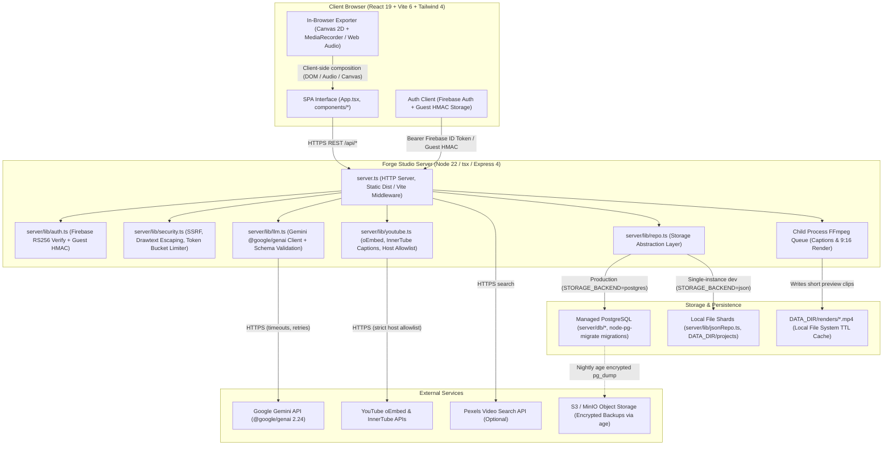

# Forge Studio — Architecture Assessment

**File:** `engineering/ARCHITECTURE.md`  
**Standard:** Gate 0 / Gate 1 Compliance  
**Audited Against:** Codebase at commit `dffa550` (`docs/SYSTEM_ARCHITECTURE.md`, `server.ts`, `server/lib/*`, `server/db/*`, `src/*`, `Dockerfile`, `.github/workflows/ci.yml`)

---

## 1. Overview & System Scope

Forge Studio is an **AI YouTube Shorts studio application** designed to automate the creation pipeline:  
`Script Idea / YouTube Source / Prompt → Script & Scene Breakdown → Audio & Captions → 9:16 Preview & Video Export`.

> **Scope Verification:** As documented in `docs/SYSTEM_ARCHITECTURE.md`, Forge Studio is **not** a general code editor or multi-agent orchestration service. It is a media creation web application. Features not present in the codebase (e.g. external message brokers like Kafka/PubSub, external search clusters like Algolia, third-party IdPs like Auth0, or infrastructure provisioners like Terraform) are explicitly omitted or marked "not present in repo".

---

## 2. Component & Runtime Diagram

---

## 3. Data-Flow Specification

| Step | Initiator | Target / Flow | Mode | Description |
|---|---|---|---|---|
| **1. Auth Verification** | Browser | `server/lib/auth.ts` | Sync | Validates Bearer token: Firebase ID Token (RS256 via Google public certs) or Guest Token (`guest.<payload>.<HMAC-SHA256>` via `SESSION_SECRET`). Attaches `req.user`. |
| **2. Script Generation** | Browser | `server/lib/llm.ts` → Gemini | Sync (streamed / chunked) | Sends structured prompt with JSON schema constraint to `@google/genai`. Parses response with `jsonrepair` fallback. |
| **3. YouTube Caption Extraction** | Browser | `server/lib/youtube.ts` | Sync | Validates URL against host allowlist (SSRF guard), fetches captions/oEmbed metadata, formats timestamps into short script segments. |
| **4. Project Save / Update** | Browser | `server/lib/repo.ts` (`pgRepo.ts` or `jsonRepo.ts`) | Sync | Persists project metadata, scripts, scenes, and media references. Scoped strictly by `user_id`. |
| **5. Server FFmpeg Preview** | Browser | `server.ts` → child process | Async Job Queue | Enqueues job with timeout; invokes `ffmpeg` with safe argument array (no shell interpolation); renders 9:16 caption video to `DATA_DIR/renders/`. |
| **6. Client Full Video Export** | Browser | Local Canvas / Web Audio | Client-side Sync | Combines video background, TTS audio, subtitles, and transitions via Canvas 2D and `MediaRecorder` into final `.webm`/`.mp4` download without overloading server CPU. |
| **7. Backup & Offsite Archive** | Cron / Docker | `scripts/db-backup.ts` → S3/MinIO | Batch Async | Runs `pg_dump`, encrypts archive with `age` public key, uploads to S3-compatible bucket with checksum verification. |

---

## 4. Infrastructure & Deployment Provenance

| Component | Codebase Asset | Status in Repo |
|---|---|---|
| **App Container** | `Dockerfile` (Multi-stage: `oven/bun:1.4` build → `node:22-slim` runtime + `ffmpeg`, `tini`, `curl`) | Present & Active |
| **Backup Container** | `Dockerfile.backup` (Postgres client + `age` encryption + AWS SDK) | Present & Active |
| **Local Orchestration** | `docker-compose.yml` (App + PostgreSQL 16 service definition) | Present & Active |
| **CI/CD Automation** | `.github/workflows/ci.yml` (Typecheck, Postgres integration tests, Playwright E2E, Docker smoke tests) | Present & Active |
| **Database Migrations** | `server/db/migrations/*.sql` (Executed on startup via advisory lock in `server/db/pool.ts`) | Present & Active |
| **Cloud Provisioning / IaC** | Terraform / Helm / Kubernetes / CloudFormation | **Not Present in Repo** (Deployment is containerized; target infra agnostic) |
| **Message Queues / Bus** | Kafka / RabbitMQ / Google Pub/Sub | **Not Present in Repo** (PostgreSQL table `jobs` with `SKIP LOCKED` used for queuing) |
| **External Cache Clusters** | Redis / Memcached / Memorystore | **Not Present in Repo** (In-memory token buckets & Postgres rate tracking used) |

---

## 5. Architectural Strengths & Technical Risks

### Strengths
1. **Zero-Shell Execution:** All FFmpeg commands use `child_process.spawn` with explicit argument arrays, preventing shell injection vulnerabilities.
2. **Dual-Backend Persistence:** The storage abstraction layer (`Repo` interface) cleanly decouples application routes from the physical persistence mechanism (Postgres vs JSON).
3. **Client-Side Heavy Rendering:** Offloading final video canvas composition to client browsers preserves server resources while keeping server renders light.
4. **Strong SSRF & Host Guardrails:** `server/lib/security.ts` and `youtube.ts` enforce strict private-IP and hostname checks before fetching external resources.

### Technical Risks
1. **Monolithic `server.ts`:** The main Express entry file exceeds 140KB containing multiple route handlers that should be factored into modular route controllers.
2. **Local Render Disk Fill:** The preview render cache (`DATA_DIR/renders`) requires strict TTL sweeping to avoid disk exhaustion under high volume.
3. **Turnstile CAPTCHA Reliance:** Production requires Cloudflare Turnstile token validation; CI disables this via `CAPTCHA_REQUIRED=false`.
