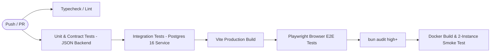

# DevOps & Infrastructure Audit

**File:** `engineering/DEVOPS_AUDIT.md`  
**Scope:** `Dockerfile`, `Dockerfile.backup`, `docker-compose.yml`, `.github/workflows/ci.yml`, `scripts/`  
**Reference Codebase Commit:** `dffa550` (main branch)

---

## 1. Executive Summary

Forge Studio provides a clean containerized deployment model with multi-stage Docker builds, non-root user execution (`USER node`), process signal reaping via `tini`, built-in container healthchecks, and an automated offsite backup pipeline using streaming `pg_dump`, `age` asymmetric encryption, and S3-compatible object storage.

### Top Findings & Observations
1. **[Pass] Multi-Stage Dockerfile:** The build stage uses `oven/bun:1.4` for fast package installation and Vite compilation; the runtime stage uses `node:22-slim` containing only production runtime dependencies and system tools (`ffmpeg`, `curl`, `tini`).
2. **[Pass] Least Privilege Container Runtime:** `Dockerfile` switches to unprivileged user `node` (`USER node`) before entrypoint execution.
3. **[Pass] Robust Signal Handling & Healthcheck:** The container uses `tini` (`/usr/bin/tini --`) as PID 1 to reap zombie processes from FFmpeg subprocesses, and declares a `HEALTHCHECK` probing `GET /api/ready`.
4. **[Pass] Multi-Instance CI Smoke Test:** `.github/workflows/ci.yml` spins up two independent application containers against a shared PostgreSQL instance, creating a project on instance 1 and verifying reads on instance 2.
5. **[Medium] Floating Base Image Tags:** `Dockerfile` uses `node:22-slim` and `oven/bun:1.4` rather than sha256 digest pinning.

---

## 2. Container Build & Runtime Topology

### Primary Container (`Dockerfile`)
* **Stage 1 (Build):**
  * Base: `oven/bun:1.4`
  * Action: `bun install --frozen-lockfile` and `bunx vite build` -> outputs static assets to `dist/`.
* **Stage 2 (Runtime):**
  * Base: `node:22-slim`
  * System Packages: `ffmpeg`, `ca-certificates`, `tini`, `curl`.
  * User: `node` (UID 1000).
  * Storage Volume: `/data` mounted for local render cache and fallback JSON files.
  * Entrypoint: `["/usr/bin/tini", "--"]` -> `CMD ["node", "--import", "tsx", "server.ts"]`.

### Backup Container (`Dockerfile.backup`)
* Dedicated container image executing `scripts/db-backup.ts`.
* Packages: `postgresql-client`, `age` encryption binary, and AWS S3 SDK.
* Performs streaming encrypted backups without writing unencrypted dumps to disk.

---

## 3. Continuous Integration Pipeline (`.github/workflows/ci.yml`)

The GitHub Actions workflow runs on every push to `main` and all pull requests:

* **Timeout:** Bounded to 40 minutes.
* **Fail-Safe:** `REQUIRE_PG_TESTS=1` ensures Postgres integration tests cannot be silently skipped if the database service fails to bind.

---

## 4. Backup, Disaster Recovery & Retention

* **Database Engine:** PostgreSQL 16.
* **Encryption Standard:** Backups are encrypted at rest using `age` (modern X25519/ChaCha20-Poly1305 asymmetric encryption) before leaving the database host.
* **Storage Target:** S3-compatible object storage (AWS S3, MinIO, or Cloudflare R2).
* **Restoration Verification:** Automated verification script (`scripts/backup.ts verify`) checks archive integrity and decryption readiness nightly.

---

## 5. Recommendations

1. **Digest Pinning for Base Images:** Pin Docker base images to explicit digests (e.g. `node:22-slim@sha256:...`) to guarantee bit-for-bit reproducible builds.
2. **Prometheus Endpoint Scraping:** Expose standard `/metrics` endpoint in container definitions for Prometheus / Grafana scraping.
3. **Structured Helm/Compose for Production:** Provide a production-hardened `docker-compose.prod.yml` or Kubernetes deployment manifest with explicit CPU/memory limits (`resources.limits`).

