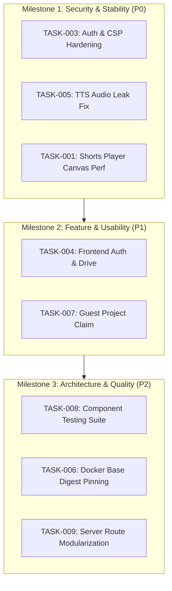

# Forge Studio — Implementation Plan (Gate 2)

**File:** `engineering/IMPLEMENTATION_PLAN.md`  
**Governing Standard:** Gate 2 Compliance (`.agents/rules/approval-gates.md`)  
**Status:** PROPOSED FOR G2 APPROVAL  

---

## 1. Plan Overview & Objectives

Based on the G4-approved specialist audits, this plan outlines the prioritized execution backlog, branch isolation strategy, testing gates, and review sequence for addressing identified optimizations, features, and technical debt.

---

## 2. Worktree & Task Backlog Matrix

| Task ID | Type | Owner | Branch / Worktree | Scope & Description | Affected Files | Dependencies |
|---|---|---|---|---|---|---|
| **TASK-001** | `fix` | `frontend-engineer` | `fix/TASK-001-shorts-player-perf` | Canvas 2D frame rate & subtitle render optimization | `src/components/ShortsPlayer.tsx` | None |
| **TASK-003** | `fix` | `backend-engineer` | `fix/TASK-003-auth-csp-hardening` | Strict CSP policy headers & auth timing protection | `server/lib/auth.ts`, `server/lib/security.ts` | None |
| **TASK-004** | `fix` | `frontend-engineer` | `fix/TASK-004-frontend-auth-drive` | Google Drive export token refresh & session fallback | `src/App.tsx`, `src/utils/googleDrive.ts` | None |
| **TASK-005** | `fix` | `frontend-engineer` | `fix/TASK-005-api-checks-tts-leak` | Web Audio context cleanup on component unmount | `src/utils/audio.ts`, `ScriptEditor.tsx` | None |
| **TASK-006** | `chore` | `devops-engineer` | `chore/TASK-006-ci-docker-pinning` | Digest pinning for base images (`node`, `bun`) | `Dockerfile`, `.github/workflows/ci.yml` | None |
| **TASK-007** | `feat` | `backend-engineer` | `feat/TASK-007-guest-project-claim` | Authenticated guest project ownership transfer | `server/lib/projectStore.ts`, `repo.ts` | None |
| **TASK-008** | `chore` | `qa-engineer` | `chore/TASK-008-frontend-tests-lint` | Frontend component unit tests & test runner config | `tests/components/*`, `package.json` | None |
| **TASK-009** | `refactor` | `backend-engineer` | `refactor/TASK-009-server-routes` | Modularize `server.ts` into `server/routes/*` | `server.ts`, `server/routes/*` | TASK-003, TASK-007 |

---

## 3. Milestones & Staged Rollout

---

## 4. Verification & Gate Sequence per Task

Each task follows strict gate progression:
1. **G3 (Implementation & Verification):** Code authored in `.worktrees/<TASK_ID>`; typechecks and tests pass.
2. **G4 (Specialist & Independent Review):** `qa-engineer` and `independent-reviewer` independently verify diff and edge cases.
3. **Commit & PR:** Commit authored following conventional format (`fix(TASK-001): ...`).
4. **G5 (CTO Merge Approval):** Merge branch into `main` after PR verification.

